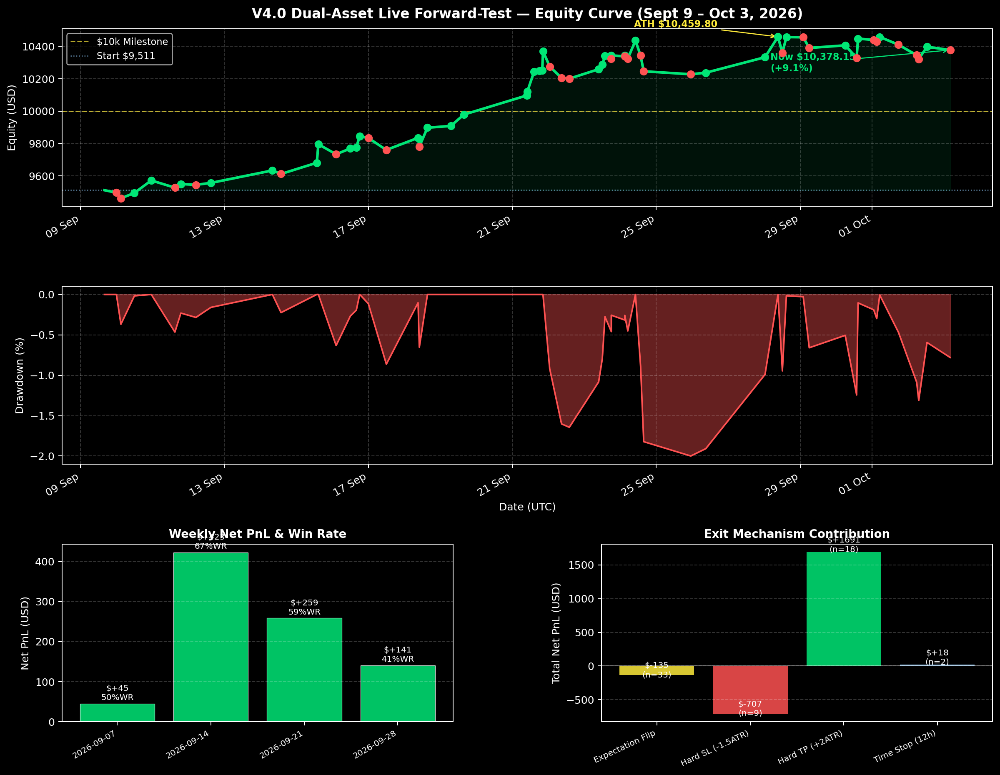

# Algorithmic Trading System V4

Dual-asset (XAUUSD, BTCUSD) H1 trading system for MetaTrader 5: a LightGBM direction classifier, a meta-labeling gate, an ATR-based exit engine and a cross-asset correlation guard.

> **Status: personal learning project, demo account only.** This repository documents an engineering and research-process exercise. It is **not** a validated trading strategy and **not** investment advice.

## TL;DR

- **What was built:** an end-to-end automated pipeline (MT5 API execution, feature engineering, two-stage LightGBM, triple-barrier labeling, rule-based exits, risk sizing, decision logging, Telegram notifications) that ran unattended on a VPS.
- **What happened:** a 24-day demo forward test (09 Sep – 03 Oct 2026) produced 62 closed trades, **+9.12%**, profit factor **1.74**, max closed-balance drawdown **−2.00%**.
- **What the evidence does and does not show:**
  - 62 trades is a small sample: the 95% confidence interval of the win rate is roughly **42%–67%**, and the test window coincided with a strong Bitcoin rally.
  - **83% of gross profit came from 18 take-profit exits.**
  - **The directional signal has no out-of-sample edge.** In the live decision logs its ROC-AUC against the next hour's move is ≈ 0.50, and the offline AUC of 0.62 falls to 0.49–0.52 once the target is recomputed on tradable prices (see [Live check of the primary signal](#live-check-of-the-primary-signal)). The demo profit therefore cannot be credited to forecasting skill. A driftless price reaches a +2.0× ATR take-profit before a −1.5× ATR stop only about 43% of the time, so the exit bracket alone creates no edge; a trending Bitcoin month and chance are the more plausible explanations, and 62 trades cannot separate them.
- **Why it is still worth reading:** the repository shows the full iteration history (V1 → V4), the bugs found and fixed, a leakage audit, and scripts that let you recompute every headline number from the raw logs.

## What was forward-tested vs. what the code trains today

| | **v4.0 (forward-tested)** | **v4.1** | **v4.2 (current training script)** |
|---|---|---|---|
| Training target | Next-bar direction of the mid-range price `(High + Low) / 2` | same as v4.0 | Next-bar **close-to-close** direction (tradable) |
| Triple-barrier entry price | Bar mid-range | same as v4.0 | `Close` of the signal bar |
| Meta-model input | `primary_prob` computed **in-sample** (leakage) | out-of-fold (`TimeSeriesSplit`, 5 folds) | out-of-fold |
| Primary model | LightGBM, last 2,500 H1 bars | identical files to v4.0 | retrained |
| Offline primary OOF AUC | 0.62 (artifact of the target) | 0.62 (artifact of the target) | **0.51** |
| Status | Produced all 62 trades below | Retrained 18 Nov 2026, never forward-tested | Retrained 19 Nov 2026, never forward-tested |

All forward-test statistics in this README belong to **v4.0**. v4.1 and v4.2 were validated offline only, so forward-test and offline figures must not be read as one continuous experiment.

## Architecture

```
H1 OHLC (MT5)
   │
   ▼
Features: log-returns (lag 1–5), realized vol (10/20), ATR(14), RSI(14), MACD, ROC(10), distance to SMA(20/50)
   │
   ▼
Primary LightGBM classifier  ──►  P(up) for the next bar; live signal: BUY if P ≥ 0.55, SELL if P ≤ 0.45, else no trade
   │
   ▼
Meta-model gate (LightGBM)   ──►  trade only if P(meta) ≥ 0.54
   │                               label = 1 if the take-profit barrier is hit first (stop-loss is checked first
   │                               within a bar), or the 12-bar timeout ends with a return above +0.1%
   │                               bet size multiplier 0.6×–1.2× scaled with P(meta)
   ▼
Position sizing: risk budget 0.75% of equity per trade, ÷ stop distance, × meta multiplier × correlation haircut
   │
   ▼
Exit engine (first condition that fires wins)
   1. Hard take-profit   +2.0 × ATR
   2. Hard stop-loss     −1.5 × ATR
   3. Profit lock        trailing floor (0.2 × ATR) after +1.5 × ATR unrealized profit
   4. Expectation flip   close if P(up) reverses across 0.50
   5. Time stop          12 H1 bars
```

**Correlation guard:** 480-bar rolling Pearson correlation between Gold and BTC log-returns. Above |ρ| = 0.40 the lot size is cut linearly, reaching a 50% haircut at |ρ| = 1.0 (`correlation_guard.py`). It only reduces size; it never blocks an entry.

## Forward-test results (v4.0, demo account)

Source: `logs_sample/mt5_deals_history_demo_sept2026.csv` (62 closing deals of magic numbers 40101 / 40102). Reproduce with `python scripts/verify_forward_test.py`.

| Metric | Value |
|---|---|
| Period | 09 Sep – 03 Oct 2026 (24 calendar days) |
| Start → end balance | $9,511.11 → $10,378.15 |
| Net return | **+$867.04 (+9.12%)** |
| Closed trades | 62 (34 W / 28 L) |
| Win rate | 54.84% (95% CI ≈ 42.5%–66.6%) |
| Profit factor | 1.74 |
| Average win / loss | $59.83 / −$41.68 (payoff 1.44; break-even win rate 41%) |
| Max drawdown | −2.00% (−$208.68), measured on the **closed-trade balance** (floating P/L not included) |
| Max consecutive losses | 3 |

An annualized Sharpe ratio is deliberately **not reported**: 24 days is far too short to annualize, and an earlier proxy value (6.7) was an artifact of that.



*Balance after each closed trade (not floating equity).*

### Per asset

| Instrument | Trades | Win rate | Net PnL | Profit factor | Standalone max DD* |
|---|---|---|---|---|---|
| BTCUSDm | 34 | 58.8% (20W / 14L) | +$578.30 | 1.78 | −3.56% |
| XAUUSDm | 28 | 50.0% (14W / 14L) | +$288.74 | 1.68 | −1.89% |

\*Closed-trade balance of that asset's trades alone, starting from $9,511.11.

Gold's win rate is exactly a coin flip; its profit comes from average wins ($51) exceeding average losses ($31) in this sample, which with 28 trades is well within chance.

### Where the money came from

| Exit type | Trades | Net PnL | Avg per trade |
|---|---|---|---|
| Hard TP (+2.0× ATR) | 18 | +$1,691.02 | +$93.95 |
| Expectation flip | 33 | −$134.51 | −$4.08 |
| Hard SL (−1.5× ATR) | 9 | −$707.48 | −$78.61 |
| Time stop (12 bars) | 2 | +$18.01 | +$9.00 |

The 18 take-profit exits equal **83.1% of gross profit** ($2,034.13). In a low-volatility, range-bound regime where price rarely travels 2× ATR, this profile would likely turn negative.

### Weekly breakdown

| Week | Trades | Win rate | Net PnL |
|---|---|---|---|
| 09 – 14 Sep | 8 | 50.0% | +$44.95 |
| 14 – 21 Sep | 15 | 66.7% | +$422.57 |
| 21 – 28 Sep | 22 | 59.1% | +$258.91 |
| 28 Sep – 03 Oct | 17 | 41.2% (≈ break-even) | +$140.61 |

The last week's win rate sits at break-even. With 17 trades it is impossible to tell noise from the start of a regime change.

## Offline validation (v4.2 pipeline, tradable target)

Run on 2,500 H1 bars per asset (Gold: 19 Mar – 20 Aug 2026, BTC: 26 May – 07 Sep 2026) with a 5-fold `TimeSeriesSplit` and out-of-fold primary probabilities; metrics are in `docs/OFFLINE_VALIDATION_REPORT.json`.

| Metric | Gold | BTC |
|---|---|---|
| Primary in-sample AUC | 0.719 | 0.705 |
| **Primary out-of-fold AUC** | **0.513** | **0.513** |
| Primary OOF accuracy / Brier | 52.0% / 0.2545 | 51.6% / 0.2557 |
| Meta baseline success rate (no gate) | 43.75% | 39.85% |
| **Meta-model OOF AUC** | **0.535** | **0.482** |
| Meta precision at P(meta) ≥ 0.54 | 48.41% | 38.75% |
| Precision lift vs baseline | +4.67 pp | −1.10 pp |
| Signals rejected by the gate | 69.3% | 90.3% |

How to read this:

- The primary model overfits heavily (about 0.2 AUC between in-sample and out-of-fold) and its out-of-fold AUC of 0.51 is at noise level.
- The meta-model shows a small positive lift on Gold and a negative one on BTC. Because triple-barrier labels span up to 12 overlapping bars, the effective sample is far smaller than the 2,055 events, so the Gold lift cannot be called skill.
- The earlier 0.62 primary AUC (v4.0 / v4.1, mid-range target) was an artifact; see below.

## Live check of the primary signal

The per-hour decision logs record every `primary_prob` the live engine produced. Because the models were frozen before the forward test, these are genuine out-of-sample predictions of the **v4.0** model. Reproduce with `python scripts/live_signal_check.py`.

| Instrument | Bars | ROC-AUC vs next-hour move (95% CI) | BUY/SELL hit-rate |
|---|---|---|---|
| BTCUSD | 597 | **0.502** (0.457 – 0.547) | 49.1% (287 signals) |
| XAUUSD | 378 | **0.505** (0.446 – 0.563) | 51.6% (153 signals) |

The offline out-of-fold AUC of 0.62 is **not** visible live: the confidence intervals exclude it. In the same window the live meta-gate rejected 77.5% (BTC) and 72.5% (Gold) of directional signals.

*Data note:* the engine can log several rows per hour. The Gold log has 604 rows but only 379 distinct hours, because the Friday-close hour (20:00 UTC) was logged 44–51 times by the market-closed bug listed below. The script keeps the first row of each hour.

### Why the offline AUC was inflated

The training target and the triple-barrier entry price are defined on mid-range prices, `(High + Low) / 2`, which cannot be traded: an order sent when bar *t* closes fills near `Close[t]`, not `Mid[t]`. Where the bar closed relative to its own mid-range is already known at prediction time and is a large part of `Mid[t+1] − Mid[t]`, so the target is partly predictable without any forecasting skill.

To test this, the primary model was retrained on the same 2,500 bars per asset with the same 5-fold `TimeSeriesSplit`, changing only the target:

| Instrument | Target | OOF AUC | OOF accuracy |
|---|---|---|---|
| XAUUSD | Mid-to-mid (original) | 0.620 | 58.7% |
| XAUUSD | Close-to-close (tradable) | 0.487 | 48.2% |
| XAUUSD | Next open-to-close (tradable) | 0.491 | 50.0% |
| BTCUSD | Mid-to-mid (original) | 0.623 | 59.0% |
| BTCUSD | Close-to-close (tradable) | 0.515 | 51.5% |
| BTCUSD | Next open-to-close (tradable) | 0.515 | 51.5% |

About 2,450 valid bars per asset. The original-target figures come from a separate run of the experiment (the earlier v4.1 report gave 0.621 and 0.620).

With a tradable target the out-of-fold AUC drops to 0.49–0.52, in line with the live AUC of about 0.50 measured above. Each estimate carries roughly ±0.03–0.05 of sampling noise, so the honest reading is "no detectable directional skill", not "exactly zero". Script: `scripts/tradable_target_experiment.py`.

### What explains the demo profit?

Not forecasting skill. The exit bracket does not create an edge by itself either: for a driftless price, a +2.0× ATR take-profit is reached before a −1.5× ATR stop with probability 1.5 / (2.0 + 1.5) ≈ 43%, which has zero expected value before costs. The more plausible explanations are the strongly trending Bitcoin month (83% of gross profit came from 18 take-profit exits) and chance; with 62 trades the two cannot be separated. Retraining on a tradable target (v4.2) gives an out-of-fold AUC of 0.51 on both assets, so none of the versions has a demonstrated directional edge.

## Version history

All trades below come from the demo account; magic numbers identify the system version in the deal history. Statistics for V1–V3.6 are from the same MT5 deal history. The account also contains earlier manual, discretionary trades that are not part of any algorithm and are excluded from every number in this repository.

| Version | Magic | Instrument | Period (2026) | Closed trades | Net PnL | Outcome |
|---|---|---|---|---|---|---|
| V1.0 | 990011 | XAUUSD | 24 Jul | 2 | +$141.77 | First live smoke test of a LightGBM regression prototype; far too few trades to conclude anything |
| V2.0 | 202608 | XAUUSD | 07 – 20 Aug | 37 | −$635.54 | Single-asset classifier with a pure reversal exit; 27.0% win rate, profits bled away by spread and churn |
| V3.6 | 202609 | XAUUSD | 25 Aug – 09 Sep | 15 | +$10.40 | Hierarchical logic with a news shield; flat in a choppy market |
| V3.6 | 202610 | BTCUSD | 30 Aug – 07 Sep | 9 | −$39.99 | Twin BTC bot running without any cross-asset guard; flat |
| **V4.0** | 40101 / 40102 | XAUUSD / BTCUSD | 09 Sep – 03 Oct | 62 | **+$867.04** | Meta-labeling gate, decoupled exit engine, correlation guard |

Takeaway: V2.0 failed through its exit logic and costs, V3.6 was flat, and V4.0 was profitable over a short, favorable window. Three or four iterations on the same demo account also means some selection effect: V4.0 is the version that happened to look best, which is one more reason not to over-read its 24 days.

## Known issues and fixed bugs

| Issue | Status |
|---|---|
| **Correlation guard stuck at 0.28 during the demo.** BTC trades 24/7 while Gold closes on weekends, so the 480-bar correlation was always `NaN` and fell back to a default. The haircut never activated. | Patched (800 bars fetched, `min_periods=60`); not re-validated in a later live session |
| **Repeated order attempts while the market was closed** (17 tries on 25 Sep, 20:00 UTC). | Patched (`trade_mode` check) |
| **Meta-model trained on in-sample primary probabilities.** | Fixed in v4.1 (out-of-fold); not forward-tested |
| **Training target and labeler entry used mid-range prices** (non-tradable). Confirmed as the source of the inflated 0.62 offline AUC. | Fixed in v4.2 (close-to-close target, `Close` entry); offline only, not forward-tested |
| **Duplicate rows in the Gold decision log** (604 rows, 379 distinct hours; the Friday-close hour appears 44–51 times). | Explained by the market-closed bug; logs kept as recorded, analysis scripts keep the first row per hour |
| **Statistical power.** 62 trades, one regime, one month. | Needs 150–200+ trades across trending, ranging and shock regimes |
| **No transaction costs in training or offline metrics.** The training script creates a constant `Spread` column but never uses it, so offline labels and metrics are gross of spread, slippage and requotes. Only the demo forward test reflects real fills. | Open |
| **Train/serve skew in the meta-model.** It is trained on every bar with the side taken at P ≥ 0.50, but live it only sees signals outside the 0.45–0.55 dead-band. Offline rejection rates are therefore not comparable with live ones. | Open |
| **Drawdown is closed-balance only.** Floating drawdown inside open trades is not captured. | Open |

## Repository structure

```
algorithmic-trading-system-v4/
├── src/
│   ├── live_forward_test_v4_meta.py   # live execution engine
│   ├── train_v4_meta_system.py        # trains primary + meta models (v4.1, out-of-fold)
│   ├── triple_barrier_labeler.py      # triple-barrier labeling
│   ├── correlation_guard.py           # cross-asset lot haircut
│   ├── live_decision_logger.py        # per-bar decision log
│   ├── telegram_notifier.py           # notifications
│   └── export_live_data.py            # export deal history from MT5
├── models/
│   ├── v4.0_forward_tested/           # models that produced the 62 trades
│   ├── v4.1_oof/                      # retrained with out-of-fold meta inputs (not forward-tested)
│   ├── v4.2_tradable_target/          # retrained on tradable close-to-close targets
│   └── v4_metadata.json
├── logs_sample/
│   ├── hourly_decisions_gold.csv
│   ├── hourly_decisions_btc.csv
│   └── mt5_deals_history_demo_sept2026.csv   # the 62 closed V4.0 deals only
├── scripts/
│   ├── verify_forward_test.py         # recompute forward-test statistics from the deal history
│   ├── live_signal_check.py           # out-of-sample AUC of the live primary signal
│   └── tradable_target_experiment.py  # reproduce target tradability comparison
├── docs/
│   ├── live_equity_growth_chart.png
│   └── OFFLINE_VALIDATION_REPORT.json
├── run_v4_live_system.bat
├── requirements.txt
└── .env.example
```

## Running it

Requirements: Windows (the `MetaTrader5` package is Windows-only), an installed and logged-in MT5 terminal, Python 3.10+.

```bash
git clone https://github.com/rayyanfrds/algorithmic-trading-system-v4.git
cd algorithmic-trading-system-v4
pip install -r requirements.txt
copy .env.example .env      # then fill in your own MT5 / Telegram credentials

python src/live_forward_test_v4_meta.py     # live engine (demo account recommended)
python src/train_v4_meta_system.py          # retrain; needs H1 data in data/
python scripts/verify_forward_test.py       # recompute the forward-test statistics
python scripts/live_signal_check.py         # recompute the live AUC check
python scripts/tradable_target_experiment.py # reproduce target tradability comparison
```

Training data is not included. Export H1 bars for XAUUSD and BTCUSD from the MT5 terminal (History Center) and save them as the parquet files named in `src/train_v4_meta_system.py`.

The `.pkl` model files are Python pickles; only load pickles from sources you trust.

## Disclaimer

For educational and personal research purposes only. Nothing here is investment advice. Past performance, especially over 24 demo days, does not predict future results, and trading carries a real risk of losing capital.
