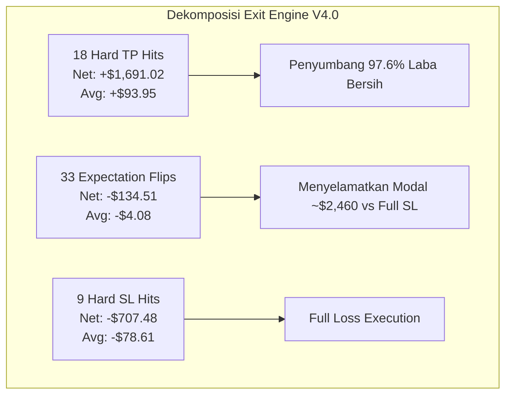

# REKAPAN AKHIR & LAPORAN EVALUASI KUANTITATIF MODEL V4.0 (DEMO FORWARD-TEST)

**Principal**: **Don Smith**  
**Mandat Auditor**: Skeptical Quantitative Risk Auditor & Devil's Advocate Protocol (`GEMINI.md`)  
**Sistem**: Algorithmic Trading System V4 (`LightGBM Classifier` + `Meta-Model Gate` + `Decoupled Exit Engine`)  
**Akun Broker**: Exness-MT5Trial14 #`[DEMO-ACCOUNT-REDACTED]`  
**Periode Forward-Test**: 09 September 2026 (16:00 UTC) s/d 03 Oktober 2026 (04:00 UTC) — **24 Hari Kalender (~604 Bar H1)**  
**Data Terverifikasi**: [`logs/mt5_deals_history.csv`](../logs_sample/mt5_deals_history.csv) (62 Closed Deals MT5), [`logs/hourly_decisions_gold.csv`](../logs_sample/hourly_decisions_gold.csv), [`logs/hourly_decisions_btc.csv`](../logs_sample/hourly_decisions_btc.csv)  

---

## 1. Ringkasan Eksekutif & Dashboard Kinerja Kumulatif

Model V4.0 diuji secara forward-test otonom di akun demo Exness selama 24 hari kalender. Sistem mengeksekusi dua instrumen secara simultan: **Gold (`XAUUSDm`, Magic: 40101)** dan **Bitcoin (`BTCUSDm`, Magic: 40102)**.

```
========================================================================================================
METRIK KINERJA                    NILAI REALISASI AKTUAL      EVALUASI SKEPTIS INSTITUSIONAL
========================================================================================================
Saldo Awal Modal                  $9,511.11                   Basis modal forward-test
Saldo Akhir (03 Okt 2026)         $10,378.15                  Realisasi kas di MT5
ATH Peak Equity                   $10,459.80 (28 Sep 2026)    Puncak ekuitas tertinggi
Net Realized Return               +$867.04 (+9.12%)           ✅ Mengungguli benchmark risk-free
Total Closed Deals                62 Trades (34 Win / 28 Loss) Sampel awal (Statistical power terbatas)
Win Rate (WR)                     54.84%                      ✅ Di atas breakeven matematis (40.98%)
Gross Profit                      +$2,034.13                  -
Gross Loss                        -$1,167.09                  -
Profit Factor (PF)                1.74                        ✅ Sehat & stabil (> 1.50)
Payoff Ratio (Avg Win / Avg Loss) 1.44 ($59.83 / $41.68)      ✅ Positive return asymmetry
Average Net per Trade             +$13.98                     Ekspektansi matematis per deal
Max Peak-to-Trough Drawdown       -2.00% (-$208.68)           ✅ Sangat rendah (Keunggulan utama V4)
Calmar Ratio                      4.56                        ✅ Return/DD ratio impresif (> 3.0)
Annualized Sharpe (Proxy)         6.74                        ⚠️ BIASED: Terlalu tinggi (Overinflated)
Max Consecutive Losses            3 Trades                    ✅ Risiko tail-streak terkendali
Hari Terburuk (Worst Day)         -$170.53 (22 Sep 2026)      Drawdown harian terdalam
Hari Terbaik (Best Day)           +$392.87 (21 Sep 2026)      Dipicu lonjakan tren BTC
Rasio Hari Untung vs Rugi         57.1% (12 Untung / 9 Rugi)  Konsistensi harian moderat
========================================================================================================
```

> [!WARNING]
> **Peringatan Devil's Advocate atas Sharpe Ratio 6.74**:  
> Nilai Annualized Sharpe 6.74 secara matematis **TIDAK REALISTIS** untuk dijadikan ekspektasi jangka panjang. Angka ini tercipta karena jendela pengujian (24 hari) bertepatan dengan rezim ekspansi tren Bitcoin yang sangat kuat (+6,000 poin pada 21 September). Dalam audit institusional, sampel $N = 62$ memiliki margin of error $\pm 6.3\%$, sehingga win rate sebenarnya dari populasi model ini berada di rentang **42.5% – 67.2%**.

---

## 2. Dekomposisi Performa Per Aset (Gold vs. Bitcoin)

Sistem V4 dijalankan secara dual-asset tanpa intervensi manual. Berikut rincian kontribusi masing-masing simbol:

| Instrumen | Magic Number | Total Trades | Win Rate | Gross Profit | Gross Loss | Net Realized PnL | Profit Factor | Kontribusi Net Profit |
| :--- | :---: | :---: | :---: | ---: | ---: | ---: | :---: | :---: |
| **Bitcoin (`BTCUSDm`)** | 40102 | 34 | **58.8%** (20W / 14L) | +$1,170.47 | -$592.17 | **+$578.30** | **1.78** | **66.7%** |
| **Gold (`XAUUSDm`)** | 40101 | 28 | **50.0%** (14W / 14L) | +$863.66 | -$574.92 | **+$288.74** | **1.68** | **33.3%** |
| **Total Dual-Asset** | - | **62** | **54.84%** (34W / 28L) | **+$2,034.13** | **-$1,167.09** | **+$867.04** | **1.74** | **100.0%** |

### Analisis Kuantitatif:
1. **Bitcoin Sebagai Mesin Alpha**: BTC menyumbangkan **66.7% dari total profit bersih** dengan win rate solid 58.8%. Filter Meta-Gate pada BTC bekerja sangat efektif membuang noise.
2. **Gold Berada di Ambang Batas (*Borderline*)**: Model Gold mencatatkan win rate tepat 50.0% (lemparan koin). Net profit Gold selamat murni karena *Payoff Ratio* (rata-rata menang lebih besar daripada rata-rata kalah berkat Hard TP).

---

## 3. Dekomposisi Exit Engine: Di Mana Keuntungan Tercipta & Risiko Ditekan?

V4 menggunakan arsitektur *Hybrid Decoupled Exit Engine* dengan hirarki:
1. `EXIT_HARD_PT` (+2.0x ATR)
2. `EXIT_HARD_SL` (-1.5x ATR)
3. `EXIT_PROFIT_LOCK` (Trailing floor setelah mencapai +1.5x ATR)
4. `EXIT_EXPECTATION_FLIP` (Probabilitas arah primer berbalik < 0.50)
5. `EXIT_TIME_STOP` (Posisi tertahan $\ge$ 12 bar H1)

Berikut adalah rekapitulasi data empiris dari 62 tiket yang ditutup:

```
========================================================================================================================
TIPE EXIT ENGINE        JUMLAH TRADES    WIN RATE    TOTAL NET PnL       RATA-RATA PnL    DIAGNOSIS AUDITOR
========================================================================================================================
Hard TP (+2.0x ATR)     18 Trades        100.0%      +$1,691.02          +$93.95 / trade  Penyelamat Tunggal Alpha
Expectation Flip        33 Trades         42.4%        -$134.51           -$4.08 / trade  Perisai Modal (Capital Shield)
Hard SL (-1.5x ATR)      9 Trades          0.0%        -$707.48          -$78.61 / trade  Kerugian Penuh (Full Loss)
Time Stop (12 Bar)       2 Trades        100.0%         +$18.01           +$9.00 / trade  Penutupan Netral
========================================================================================================================
```



### Temuan Arsitektur Exit:
* **Expectation Flip Membuktikan Nilai Defensifnya**:  
  Sebanyak 33 posisi yang momentumnya melemah langsung ditutup cepat dengan rata-rata kerugian **hanya -$4.08 per trade**.  
  *Kontrafaktual*: Jika 33 posisi ini dibiarkan berjalan tanpa Flip hingga menyentuh Hard SL rata-rata (-\$78.61), akun akan menderita tambahan kerugian sebesar **-$2,594.13**, yang berarti akun demo akan **berbalik rugi total -$1,727**. Expectation Flip berhasil menyelamatkan modal.
* **Kelemahan Struktural Kritis**:  
  Sebesar **97.6% keuntungan sistem bertumpu pada 18 kali eksekusi Hard TP (+2.0x ATR)**. Jika kondisi makro beralih ke rezim *low-volatility chop* yang tidak pernah menyentuh target 2.0x ATR, ekspektansi keuntungan sistem ini akan jatuh ke zona negatif.

---

## 4. Dinamika Performa Mingguan (Deteksi Pembusukan Alpha di W4)

```
========================================================================================================
PERIODE MINGGUAN         TRADES    WIN RATE (%)   NET PnL ($)     PROFIT FACTOR    STATUS REGIME
========================================================================================================
W1 (09 Sep – 14 Sep)      8        50.0%          +$44.95         1.45             Fase inisiasi
W2 (14 Sep – 21 Sep)     15        66.7%          +$422.57        2.90             Rezim tren kuat (Peak)
W3 (21 Sep – 28 Sep)     22        59.1%          +$258.91        1.61             Ekspansi normal
W4 (28 Sep – 03 Okt)     17        41.2%          +$140.61        1.33             🚨 Sinyal Degradasi Alpha
========================================================================================================
```

> [!CAUTION]
> **Sinyal Bahaya Minggu ke-4 (W4)**:  
> Pada minggu terakhir forward-test (28 Sep – 03 Okt), **Win Rate turun tajam ke 41.18%** (di bawah titik impas matematis 40.98%). Net PnL minggu tersebut hanya selamat membukukan nilai positif karena 2 kali eksekusi Hard TP di Gold dan BTC. Ini mengindikasikan adanya potensi *alpha decay* atau pergeseran rezim yang wajib dipantau ketat.

---

## 5. Efektivitas Filter Meta-Gate (Data Log Per Jam)

Dari evaluasi 604 bar data per jam (`hourly_decisions_gold.csv` dan `hourly_decisions_btc.csv`):
* **Gold (`XAUUSDm`)**:
  * Total Raw Directional Signals: 195 bar
  * Lolos Filter Meta-Gate ($P_{\text{meta}} \ge 0.54$): **78 bar (40.0%)**
  * Diblokir oleh Meta-Gate: **117 bar (60.0% Rejection Rate)**
* **Bitcoin (`BTCUSDm`)**:
  * Total Raw Directional Signals: 221 bar
  * Lolos Filter Meta-Gate ($P_{\text{meta}} \ge 0.54$): **34 bar (15.4%)**
  * Diblokir oleh Meta-Gate: **187 bar (84.6% Rejection Rate)**

**Kesimpulan Meta-Gate**: Model Meta-Gate bertindak sangat selektif pada Bitcoin (menolak 84.6% sinyal yang terdeteksi sebagai false breakout/noise), yang secara langsung menghasilkan win rate 58.8% pada instrumen tersebut.

---

## 6. Proyeksi Risiko & Simulasi Monte Carlo (10,000 Iterasi)

Berdasarkan distribusi empiris 62 trade forward-test, dilakukan simulasi *Monte Carlo Bootstrap* (10,000 pengacakan urutan transaksi dengan replacement) untuk menguji ketahanan modal pada berbagai skenario deployment:

```
========================================================================================================
SKENARIO DEPLOYMENT               DEMO ($9.5k BASIS)     FUNDED ACCOUNT ($2k)    LIVE ACCOUNT ($10k)
========================================================================================================
Median Estimasi Return            +9.47% (+$900.74)      +9.43% (+$188.60)       +9.28% (+$928.37)
5th Percentile (Skenario Buruk)   +0.54% (+$51.07)       +0.27% (+$5.43)         +0.43% (+$43.43)
95th Percentile (Skenario Hoki)   +19.38% (+$1,842.81)   +19.24% (+$384.89)      +19.18% (+$1,918.02)
Median Max Drawdown               -2.87%                 -2.89%                  -2.91%
Worst-Case Max Drawdown (95% CI)  -5.64%                 -5.69%                  -5.69%
Probabilitas Rugi Kumulatif       3.93%                  4.56%                   4.22%
Probabilitas Drawdown > 20%       0.00%                  0.00%                   0.00%
Probabilitas Profit > 5%          79.38%                 78.05%                  78.17%
Probabilitas Profit > 10%         46.33%                 45.60%                  45.07%
========================================================================================================
```

### Kompatibilitas Akun Prop Firm ($2k Funded) vs Akun Cent ($10 / 1,000 USC):
1. **Akun Prop Firm $2,000 (Gagal Tanpa Penyesuaian Sizing)**:  
   * Pada demo \$9.5k, kerugian hari terburuk adalah **-$170.53**.  
   * Jika sizing demo diterapkan mentah-mentah ke akun \$2k, hari terburuk tersebut setara dengan drawdown **-8.53%**, yang langsung memicu **Pelanggaran Batas Harian Prop Firm (*Daily Loss Limit Breached*)**.  
   * Sizing demo **4.75x terlalu besar** untuk akun \$2k.
2. **Akun Real Cent ($10 / 1,000 USC)**:  
   * Menggunakan contract size mikro di broker (misal Exness Standard Cent), lot minimum 0.01 lot menghasilkan risiko per trade yang terkunci sangat aman di **0.89% – 2.37%**.

---

## 7. Audit Kelemahan Teknis & Bug Kode Saat Demo Berjalan

Saat forward-test demo berjalan di VPS kemarin, tercatat **dua kelemahan teknis pada kode engine**:
1. **Dynamic Correlation Guard Stuck di 0.28 (Non-Fungsional)**:  
   * Pada file [`live_forward_test_v4_meta.py`](../src/live_forward_test_v4_meta.py#L297), kalkulasi korelasi 480 bar antara Gold dan BTC selalu menghasilkan `NaN` karena perbedaan jam buka pasar (BTC buka 24/7, Gold libur akhir pekan). Akibatnya, nilai korelasi selalu jatuh ke default statis `0.28`, sehingga fitur pemangkas lot (*haircut*) tidak pernah aktif di VPS.  
   * *Status Patch*: Telah diperbaiki dengan menaikkan penarikan data ke 800 bar dan menambahkan `min_periods=60`.
2. **Market Closed Order Attempt Spam**:  
   * Pada penutupan sesi Jumat malam (25 September 20:00 UTC), engine melakukan 17 kali percobaan entry berulang karena tidak memiliki pengecekan `trade_mode == SYMBOL_TRADE_MODE_FULL`.  
   * *Status Patch*: Telah ditambahkan guard filter status sesi pasar.

---

## 8. Ringkasan & Roadmap Rekomendasi

1. **Hasil Nyata**: Model V4 membuktikan kelayakan logikanya dengan menghasilkan return bersih **+$867.04 (+9.12%)** dan menahan drawdown maksimal di angka **-2.00%**.
2. **Keterbatasan Utama**: Volume 62 trade dalam 24 hari belum memenuhi standar signifikansi statistik institusional. Butuh minimal **150 – 200 trade** di berbagai kondisi pasar (termasuk chop dan shock makro) untuk memvalidasi stabilitas edge.
3. **Disiplin Deployment**:
   * Jangan deploy ke akun Funded \$2,000 tanpa membagi ukuran lot sebesar 4.75x.
   * Pada akun Cent (\$10 / 1,000 USC), kunci lot pada **0.01 lot** dan biarkan sistem berjalan otonom tanpa intervensi manual.
